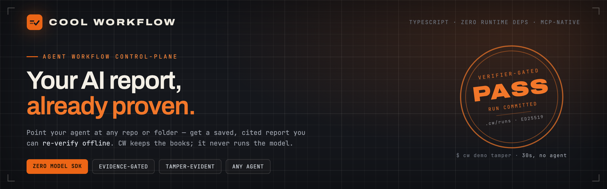

<!-- AUTO-GENERATED from /README.md by scripts/sync-readme.mjs — edit the root README, then run `npm run sync:readme`. DO NOT edit this file directly. -->
<div align="center">



### Get a saved report from your AI agent, with every claim tied to a line of code — not a chat answer you lose.

[](https://github.com/coo1white/cool-workflow/actions/workflows/ci.yml) [](https://www.npmjs.com/package/cool-workflow) [](https://www.npmjs.com/package/cool-workflow) [](https://www.npmjs.com/package/cool-workflow) [](https://github.com/coo1white/cool-workflow/tags) [](https://github.com/coo1white/cool-workflow/blob/main/LICENSE)

</div>

## What is this?

Cool Workflow (`cw`) is a small command-line tool that turns your AI coding agent's chat answer — easy to lose, hard to check — into a saved report. Point it at a repo, or any folder of docs, and:

- **It plans the work.** Your question becomes a set of small tasks.
- **Your agent does the work.** CW never runs a model itself — your own agent reads and thinks.
- **It writes a checked report.** Every claim points to a real place in your code, like `file.ts:42`. A result with no evidence stops instead of passing through.

> **The model is fuel. CW is the black-box recorder, the dashboard, and the gearbox — never the engine.**
> It never calls a model API, never holds your keys, and never uploads your code.

## Before you start

You need two things, and one more for real runs:

1. **A terminal.** On macOS: Terminal. On Linux: any. On Windows: install
   [WSL](https://learn.microsoft.com/windows/wsl/install) (run `wsl --install`
   in PowerShell, then open "Ubuntu" from the Start menu) and type every
   command below in that Ubuntu window.
2. **Node.js v22.13 or newer.** Check with `node -v`. If it is missing or
   older, get it from [nodejs.org](https://nodejs.org/) (take the LTS one).
3. **An AI coding agent, for real runs** — for one, Claude Code or Codex (see
   [Works with your agent](#works-with-your-agent)). Not needed for the demo
   in step 1 of the Quick Start.

## Install

```bash
npm install -g cool-workflow
cw version
```

`cw version` prints the version number when the install worked.

<details>
<summary>Install trouble?</summary>

| What you see | What to do |
|---|---|
| `EACCES: permission denied` | Do not use `sudo`. Put Node in your home folder with [nvm](https://github.com/nvm-sh/nvm), then run the install again. |
| `cw: command not found` | Close the terminal and open a new one. If it is still not found, `npm prefix -g` gives the folder; its `bin` folder needs to be on your `PATH`. |
| `Unsupported engine` or a Node error | Your Node is older than v22.13: update it (`node -v` to check). |
</details>

<details>
<summary>Or install with <b>Homebrew</b></summary>

```bash
brew tap coo1white/cool-workflow https://github.com/coo1white/cool-workflow
brew install coo1white/cool-workflow/cool-workflow
cw version
```

Upgrade later with `brew update && brew upgrade cool-workflow`.
</details>

**You need:** Node.js v22.13 or newer. No agent yet? Step 1 below still works — **CW never runs a model itself.**

**Runs on:** Linux, macOS and Windows through WSL. Native Windows is not yet supported: CI runs it to measure what still fails, and that work is going on.

## Works with your agent

| Agent | Flag | Status | Get it |
|---|---|---|---|
| Claude Code | `-claude` | ✅ works | [install](https://code.claude.com/docs/en/setup) |
| Codex CLI | `-codex` | ✅ works | [install](https://github.com/openai/codex) |
| Muse Code | `-muse` | ✅ works | — |
| OpenCode | `-opencode` | ✅ works | [install](https://opencode.ai/) |
| Gemini | `-gemini` | ✅ through opencode | [install OpenCode](https://opencode.ai/) |
| DeepSeek | `-deepseek` | ✅ through opencode | [install OpenCode](https://opencode.ai/) |
| GitHub Copilot CLI | `-copilot` | 🧪 beta | [install](https://github.com/github/copilot-cli) |
| Antigravity | `-antigravity` | 🧪 beta | [install](https://antigravity.google/) |
| Grok | `-grok` | ✅ works (add `-grok`) | [install](https://docs.x.ai/build/cli) |
| Cursor | — | ⬜ not yet | |
| Aider | — | ⬜ not yet | |
| Qwen Code | — | ⬜ not yet | |
| Kimi | — | ⬜ not yet | |

🧪 beta: CW has a wrapper and an offline test for it, but no real login has
been checked with it yet, and `cw` never picks it by itself: add its flag.

Log in to your agent once on its own (run it, for one `claude`, and follow
its steps) before you use it with CW: CW uses your agent as it is set up,
and never asks for your keys.

Not sure what you have? `cw doctor` checks your setup and `cw fix` prints the commands that put it right.

## Quick Start

### 1 · See it work — 30 seconds, no agent needed

```bash
cw demo tamper
# → builds a real signed ledger, forges it three ways, catches all three offline
# → VERDICT: tamper-evidence holds ✓
```

### 2 · Ask a question about your code — one command

```bash
cw -q "How does auth work end-to-end here?"
```

CW uses the current repo and the first agent it finds on your `PATH`. Want a specific agent? Add a flag from the table above, such as `-claude`.

A full review takes about 4 minutes on a real repo (14 workers; the Map and Assess stages run at the same time).

### 3 · Open the report

The report opens in your browser by itself when the run ends. It starts with the answer, then the evidence behind it. Later, open it again with:

```bash
cw report --open
```

Want to see one first? A real run's report, rebuilt on every push: **[coo1white.github.io/cool-workflow](https://coo1white.github.io/cool-workflow/)** (also at [/report.html](https://coo1white.github.io/cool-workflow/report.html)).

### 4 · Keep proof that your tests passed

An agent that says "all tests pass" has only said it. Run the tests through CW and keep a receipt:

```bash
cw check -- npm test
# → ✓ passed: npm test (exit 0 at 1a2b3c4) — receipt rc-…. Cite it as receipt:rc-…
```

CW runs your command (never a model) and saves what happened: the commit, the exit code, a digest of the output. A result that cites `receipt:rc-…` is checked again before it counts: a failed run, a missing receipt, or code that changed since the run is turned down, with the one command to fix it. `cw check list` shows your receipts.

These steps are the whole tool: CW does nothing else.

## Words you will see

| Word | What it means |
|---|---|
| **agent** | The AI coding tool on your machine (Claude Code, Codex, …) that does the reading and thinking. CW gives it small tasks. |
| **run** | One question, from start to report. Each run has an id, and its files are kept in `.cw/runs/<id>/` in your project. |
| **report** | The answer, with the evidence for each claim (`file.ts:42`). Kept as `report.md`, and opened in your browser. |
| **evidence** | A pointer to a real line of code. A claim without it is not let through. |
| **receipt** | A record, from `cw check`, that a command (for one, your tests) truly ran and how it ended. |
| **resume** | Going on with a run that stopped: `cw --resume --run <id>`. |

## Can You Trust the Report?

CW does not run the model — it keeps the books. Your agent signs its findings (**ed25519**), and `cw report verify-bundle` checks — offline, with only the public key — that every signed finding is in the report unaltered. CW holds no private key: the agent signs, CW only verifies. This proves the signed findings reached you unaltered — not that nothing else was added, and not that none were left out. See the **[Trust Model](https://github.com/coo1white/cool-workflow/blob/main/plugins/cool-workflow/docs/reference.md#trust-model)**.

## Troubleshooting

| Problem | Fix |
|---|---|
| No agent found | `cw doctor` — shows which agents are on your machine |
| `status: blocked` | Set `CW_AGENT_COMMAND=builtin:claude` or pass `-claude` |
| `claude: command not found` | Install Claude Code and run again |
| Where is my report? | `<repo>/.cw/runs/<id>/report.md`, or run `cw report --open` |
| `Missing required input: question` | Add `-q "<question>"` |
| Run stopped before the end | Fix the cause, then `cw --resume --run <id>` takes it to the end; a worker that stopped gets fresh tries (inside the project, or add `--repo <path>`) |
| `... is not a git project` | Run it inside the project, or pass `--repo` |
| `Run <id> was made for <folder>` | The run belongs to another folder (a copied or moved repo): pass `--repo <that folder>` |
| `Run <id> was made by an older cw` | This cw cannot read runs made before batch 5 of 2026-11-12; start a new one with `cw -q "<question>"` |

Something else wrong? **[Open an issue](https://github.com/coo1white/cool-workflow/issues/new/choose)** — one line on what happened is enough. A report gets a reply within a day, and the fix names you.

## Learn more

- **[User Guide](https://github.com/coo1white/cool-workflow/wiki/User-Guide)** — your first ten minutes
- **[Why Cool Workflow](https://github.com/coo1white/cool-workflow/wiki/Mental-Model)**
- **[How it works](https://github.com/coo1white/cool-workflow/wiki/Architecture)**
- **[What you can run](https://github.com/coo1white/cool-workflow/wiki/Workflow-Apps)**
- **[Trust & Audit](https://github.com/coo1white/cool-workflow/wiki/Trust-And-Audit)**
- **[Repo Map](https://github.com/coo1white/cool-workflow/wiki/Repo-Map)**
- **[Wiki home](https://github.com/coo1white/cool-workflow/wiki)**
- **[Contributing](https://github.com/coo1white/cool-workflow/blob/main/.github/CONTRIBUTING.md)** — to change CW itself: where to start for each job, the rules, and how to report a security problem

## License

BSD-2-Clause. Built by COOLWHITE LLC.
