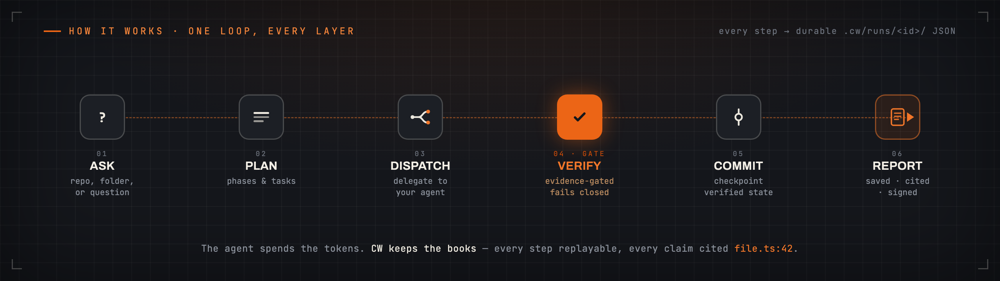

# Architecture

*For readers who want to see how CW is put together inside. To use CW, you do
not need this page — start at [Getting Started](Getting-Started.md).*

CW is built like a small operating system: a base system plus userland apps.
The runtime (the base system) owns the machinery for planning, dispatch,
state, verification, and reporting. Workflow apps, model choice, and vendor
wrappers live outside that core.

```text
workflow app -> runner -> dispatch -> isolated workers
    -> results -> feedback -> verifier gate
    -> commit/checkpoint -> report/trust audit
```

CW is a small TypeScript tool with **zero runtime dependencies**. It drives
your agent over a repo — or any folder — in saved stages that you can replay,
writing everything to disk as files you can open and read.

<div align="center">

</div>

```text
ask simple → run simple → verify simple → resume simple
```

## Core Boundary

The runtime lives under `plugins/cool-workflow/src/`. It provides:

| Area | Responsibility |
| --- | --- |
| `orchestrator` | Plans runs, loads workflows, records results, writes reports. |
| `state` | Persists `.cw/runs/<id>/state.json` and migration entry points. |
| `dispatch` and `worker-isolation` | Allocate worker scopes, manifests, and result paths. |
| `verifier` and `commit` | Validate outputs and create verifier-gated checkpoints. |
| `capability-registry` | Declares the CLI and MCP surfaces from one source. |
| `run-registry` | Indexes, resumes, archives, exports, and imports runs. |
| `telemetry` and `trust-audit` | Record usage attestations, hash chains, and decisions. |

The source tree itself (`plugins/cool-workflow/src/`, one folder per layer)
is the best maintainer map when module ownership matters.

## Delegation Boundary

CW delegates worker execution to an external process or endpoint. The agent
reads the worker input, writes `result.md`, and may report model and usage
metadata. CW records the handle and validates the result envelope, but it does
not import a model SDK or call a model API.

That boundary is why model keys stay with the agent. It is also why telemetry
verification proves *who reported the usage* and *that the record was not
changed later* — it is not a direct measurement of model usage.

## Execution Backends

Who runs a task is a driver you can change, behind one small contract. The
kernel never learns which driver ran a task, and every driver gives back the
same result and evidence shape:

| Backend | Runs the task |
| --- | --- |
| `agent` | Your agent: a command (`CW_AGENT_COMMAND`, `builtin:claude`, ...) or an HTTP endpoint (`CW_AGENT_ENDPOINT`). This is what `cw -q` and `--drive` use. |
| `node`, `bun`, `shell` | A local process (the default for plain tasks is `node`). |
| `container` | `docker run` or `podman run` (image from `--image` or `CW_CONTAINER_IMAGE`). |
| `remote`, `ci` | A remote runner or a CI job, sent by HTTP and checked until it ends (`CW_REMOTE_ENDPOINT`, `CW_CI_ENDPOINT`). |

```bash
cw backend list
cw backend probe agent --json
```

Each backend says, for each part of the sandbox profile (reads, writes,
commands, network, env), whether it puts it into force, only records it,
or cannot do it — and a backend that cannot keep a needed part **fails
closed** in place of running without it. A backend that is not configured
is refused, never made to look done. Full rules: `plugins/cool-workflow/docs/reference.md`, "Removed surfaces" (`cw man execution-backends` was removed in batch 5)
and `plugins/cool-workflow/docs/reference.md`, "Removed surfaces" (`cw man real-execution-backends` was removed in batch 5).

## How A Run Goes

```text
workflow app -> input check -> tasks -> dispatch manifests
  -> worker (your agent) writes result.md -> result check
  -> verifier gate -> verifier-gated commit or checkpoint -> report.md
```

The drive loop (`cw -q`, `cw run <app> --drive`, `cw run resume <id>
--drive`) goes round this line for you: plan, send out, take in, check,
commit. When a step fails, it tries again, then parks the worker and stops,
with the state saved, so `cw --resume --run <run-id>` can go on from there.
See `plugins/cool-workflow/docs/reference.md`, "Agents and wrappers".

## State Layout

A run is stored as plain files:

```text
<repo>/.cw/runs/<run-id>/
  state.json
  report.md
  audit/events.jsonl
  telemetry.json
  workers/<worker-id>/
  results/
  nodes/
  commits/
```

The per-run `state.json` is the source of truth. Everything else — registry
indexes, summaries, reasoning views, reports — is a view worked out
from it, and can be rebuilt from it.

## CLI And MCP

The CLI is for human speed. MCP tools are for machine context. Both route through
shared capability entries, and declared JSON payloads are parity-checked.

Examples:

- `cw app list` and `cw_app_list`
- `cw report --json` and `cw_report`
- `cw run import` and `cw_run_import`
- `cw telemetry verify` and `cw_telemetry_verify`

For more on vendor manifests and MCP boot checks, see
[MCP And Manifests](MCP-And-Manifests.md).

## Failure Discipline

When something is wrong, CW says no clearly instead of quietly working around
it:

- no agent configured -> blocked,
- invalid result envelope -> rejected or parked,
- corrupted archive -> refused or reported failed,
- stale derived index -> reported stale,
- unverifiable audit chain -> failed verification.

stdout is kept for data only. Messages for humans and live agent traces go to
stderr, and only when turned on.

## Related Pages

- [Architecture Principles](Architecture-Principles.md)
- [Workflow Apps](Workflow-Apps.md)
- [Trust And Audit](Trust-And-Audit.md)
- [Recovery And Restore](Recovery-And-Restore.md)
